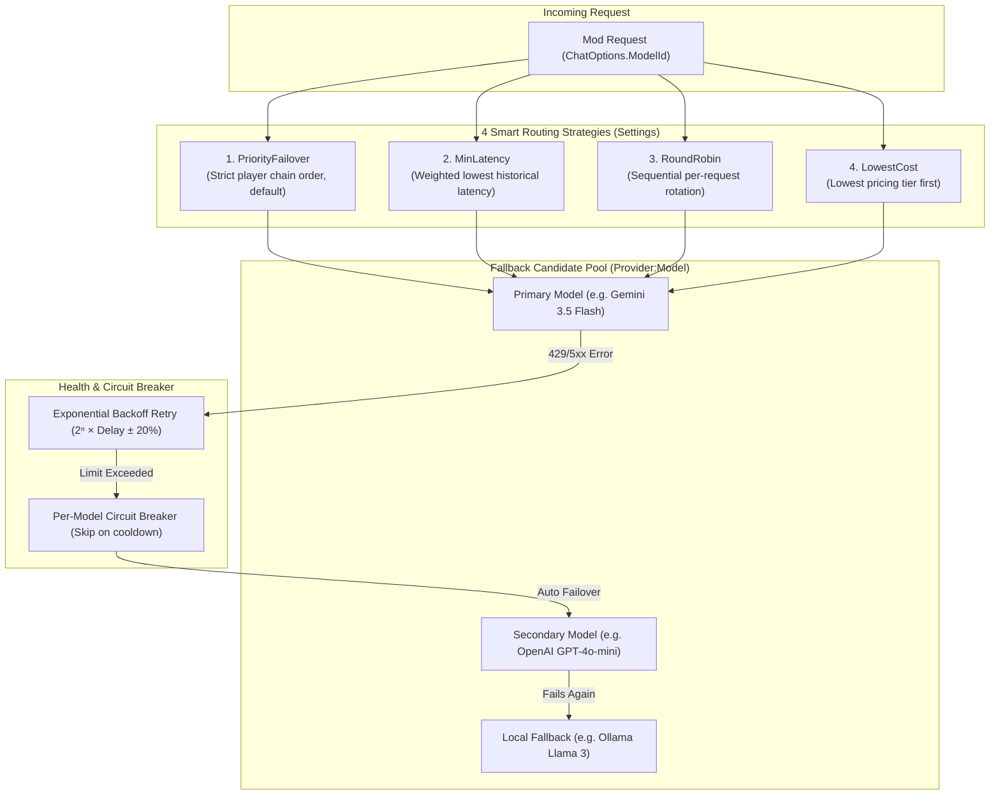
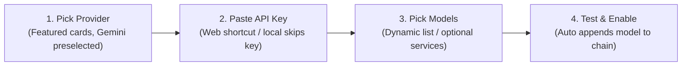
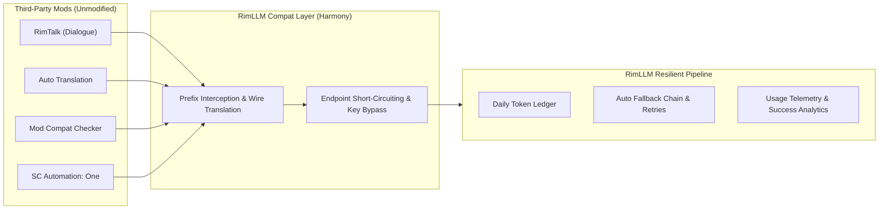

# RimLLM Framework — Features

[← Back to README](../README.md) · [繁體中文](FEATURES_zh.md)

The detailed behavior of each feature, and the reasons behind it. For SDK usage, see the README.

Supports **RimWorld 1.7 / .NET 10 only**; consuming mods must rebuild for `net10.0`. Secure storage uses Windows DPAPI, macOS Keychain, or Linux Secret Service. Development in-game tests use SmashPhil DevTools. See [Architecture](ARCHITECTURE.md) for builds, tests and native keyring requirements.

1. **Multi-provider support**
   * Native support for Google **Gemini**, **OpenAI**, **DeepSeek**, **Groq**, **Grok (xAI)**, **Z.ai**, **OpenRouter**, **Kimi**, **MiniMax**, **Qwen**, **NVIDIA** and **Player2**.
   * **Player2** (<https://player2.game/>) defaults to the local Player2 App (`http://127.0.0.1:4315/v1`): just keep the app open, no API key needed in local mode, and the model follows the app's AI Selection. It exposes no `/models` endpoint, so the cached list is a single fixed `player2` entry. To use the cloud API instead, point the endpoint at `https://api.player2.game/v1` and fill in the p2Key — cloud mode requires the key and the settings page warns when it is missing. Its USD rate is recorded as a known $0 (local play is free; cloud bills joules, which the cost estimate does not track).
   * Supports **OpenAI-compatible APIs**, so you can configure any local or third-party compatible endpoint (LM Studio, Ollama, LocalAI, vLLM, and so on). The default endpoint is `http://localhost:1234/v1` and API keys are supported.
   * **Kimi**, **MiniMax** and **Qwen** offer a one-click "use China-specific endpoint" toggle (off by default) for better connectivity.
2. **Failover and model fallback**

* **Client-side fallback chain**: configure a chain made up of a primary model and multiple exact fallback models. When the current model hits a timeout, rate limit (HTTP 429) or connection error, the framework switches down the chain seamlessly. The UI produces entries in `Provider:Model` form; the framework still parses bare provider entries for compatibility and uses the first model in that provider's fetched list (there is no built-in default model).
  * The *Model Settings* tab lists every chain entry with its tier, context-window limit and an **X** button. Removing an entry asks for confirmation and also clears that entry's manual context-window limit (and its tier override, unless another chain entry uses the same model name).
* **OpenRouter server-side fallback**: an OpenRouter entry may name several comma-separated models — set `ChatOptions.ModelId` to `"OpenRouter:model-a, model-b, model-c"` (a fallback-chain entry accepts the same form). The provider then sends OpenRouter's `models` array instead of a single `model` field, moving the choice among those models to OpenRouter's side; a single model name still sends a plain `model`. Pinned by `TestOpenRouterFallbackPayload`. Note the settings UI builds entries from the cached model list one model at a time, so this multi-model form comes from calling code rather than from the fallback-chain editor.
* `Retry-After` is honoured in both forms RFC 7231 allows — delay-seconds and HTTP-date — on every path.
* **HTTP 402 and `insufficient_quota` are not retried.** Both mean the account balance is gone; a balance does not come back within a backoff window, so the chain moves to the next candidate immediately instead of burning the retry budget first. A 429 that merely mentions "quota" (Gemini's per-minute limits) is still retried with backoff.
* **Backoff does not hold a concurrency slot.** The global `MaxConcurrentRequests` slot is taken per attempt, right around the actual API call, so a request waiting out an exponential backoff (up to 60 s) does not keep other mods' requests queued behind it.
* **Exponential backoff between retries**: the wait doubles per attempt (`RetryDelay × 2ⁿ`) with ±20% jitter, capped at 60 s. Retrying a rate limit at a fixed interval just hits the same wall again and burns the retry budget for nothing; a server-supplied `Retry-After` still wins when it asks for longer, up to the same 60 s. Beyond that the chain moves to the next candidate rather than leaving the caller waiting; if no candidate is left, the caller sees the `RateLimit` error with its `RetryAfter`.
* **Only the framework retries.** The OpenAI SDK's built-in retry is switched off: it multiplied every attempt into four HTTP requests and waited out `Retry-After` while holding a concurrency slot.
* **Exhaustion keeps the error code.** When every candidate has failed, the exception carries the last candidate's `Error`, `RetryAfter` and `HttpStatusCode`, so callers can still tell a quota problem from a bad key.
* **Failures count against the provider that failed.** Each failed candidate, including a stream that breaks midway, adds one log entry under its own provider, so the success-rate bar reflects real failures. Retries of one candidate count once; caller cancellation does not count.
* **A reply with only reasoning is a failure.** When reasoning uses up the output limit the answer is empty; non-streaming calls fall over to the next candidate, and a stream ends with `InvalidResponse` because its output has already been delivered.
* **Cooldowns are per provider *and* model.** The health ledger is keyed on `Provider:Model`. A chain often holds several models from one provider (three OpenRouter models, say), and keying on the provider alone let one rate-limited model take its healthy siblings down with it.
* **One request records one failure.** Every retry of a single request counts as one failure against the health ledger. Recording each attempt meant a single network blip — 4 attempts at the default settings — pushed a healthy target straight past the circuit-breaker threshold and removed it for minutes.
* **Routing strategies**: `PriorityFailover` (chain order, the default), `MinLatency`, `RoundRobin`, and `LowestCost`. `RoundRobin` rotates the first eligible candidate between requests instead of shuffling randomly; capability queries do not advance the rotation. `LowestCost` orders candidates by the model tier the framework already derives from API pricing, so no separate price table is needed. Ranked sorts are stable, so equally ranked candidates keep the chain's own order. A model pinned through `ChatOptions.ModelId` sits outside the rotation or sort and stays first.
* **Context window sizes**: refreshing a provider's model list also records each model's context window when the API reports one — `context_length` (OpenRouter), `context_window` (Groq), `max_model_len` (vLLM), and `inputTokenLimit` from Gemini's native `/models` endpoint, since its OpenAI-compatible one omits it. Models the API does not cover are filled from the [models.dev](https://models.dev) database (its input limit where listed, otherwise the full window), downloaded during the same refresh; OpenRouter is skipped because its API already covers every model, and OpenAI-compatible endpoints are skipped because their model names are user-defined. models.dev was chosen over LiteLLM's `model_prices_and_context_window.json` after checking both against official docs: where the two disagreed, models.dev was right more often. Each model on the Models tab shows the size and lets the player type one in (marked `*`), which takes priority. Mods read it with `RimLLMProvider.GetContextWindow`.

1. **AES-256 settings encryption**
   * API keys are stored with AES-256 symmetric encryption using a random key protected by the current OS user. Only `v3:` ciphertext is accepted. Unversioned, `v1:` and `v2:` data are rejected without opening or creating a storage key; there is no device-derived key, fixed seed, or legacy migration path.
   * Keys are also **masked in the settings UI** by default (head and tail only, so you can still tell which key is which) with a per-row toggle to reveal one for editing. This is about a different leak path from encryption: screenshots, bug reports and live streams.
   * Every provider (including Gemini) passes its API key via an HTTP header, never in the request URL, so keys don't end up in proxy or server access logs.
   * RimWorld mods all run inside the same game process. This framework makes no claim to stop a malicious mod from reading memory, reflecting over public APIs, or otherwise bypassing in-process boundaries.
2. **Settings UI**

* **Home page and setup wizard**: the window opens on a Home page whose card says in red or green whether a request can actually be sent, and why not. "Ready" means at least one fallback-chain entry has an enabled provider with a key where one is required — the same eligibility the router uses, so the card never says ready while every call would fail (`SetupStatus`, pinned by `SetupStatusTests`). The Home menu item carries the same dot on every page. The "Connect AI" wizard asks one thing per step: pick a provider (six featured cards with Gemini preselected, the rest under "More"), paste the key (with a button that opens that provider's key page; Player2 and local servers skip the key), pick the models, then press one test button. The framework never preselects a model, so step 3 enables the provider, probes for a local server when needed and fetches the model list for the player to choose the chat model from; when the list cannot be fetched or is empty, the model name can be typed instead. On the same page, services that can reuse the chat key — Embedding for Gemini and OpenAI, and for Gemini also the Gemini Decision model — fetch their own lists and offer "Don't use" plus each model; a service the player already enabled is left alone. Step 4 runs the connection test with the chosen chat model and, on success, appends exactly that model to the fallback chain, then turns on only the optional services the player picked a model for — so a single Gemini key sets up chat, Embedding and decisions. Their keys are left blank so each service reuses the chat key; each is verified with a real request (an embedding, a one-question decision) and reverts if that fails. The success screen and the Home page then list the optional services, which never affect the red/green card; services left off, other providers, and decision services unrelated to the chat provider (they need their own keys) get a button that jumps to the matching advanced page with the active provider preselected. That last step is what new players used to miss: before, a key alone did nothing until a model was added on another tab. Failures are explained by error code in plain words (wrong key, quota, offline, local server not found) with the raw message underneath for bug reports.
* **Reset to defaults**: a button at the bottom of the Home page, behind a confirmation dialog, returns every setting (API keys, providers, fallback chain, models, Embedding, decisions, timeouts and budget limits) to a fresh install. Usage stats, chat history and today's budget counters are kept, so a reset cannot be used to bypass the daily budget.
* **Advanced pages fold away**: only Home, Connect AI and the chat test are shown by default; the other pages sit under a collapsed "Advanced" group with plain-language tab names, and opening one keeps the group expanded. The timeout and budget pages add a one-line hint under each option, and the timeout page has "Reset to defaults" (`ResetRequestSettingsToDefaults`, which leaves providers, keys and the chain alone).
* Multi-column provider pages with status badges (Enabled / Disabled / Missing Key); cached models appear as chips that join the fallback chain in one click.
* A model picker with search and quick filters for popular model families.
* Chat test page: each reply shows the model that actually answered, latency and token usage (`~` marks an estimate), and can be copied or stopped mid-stream. A model picker pins one fallback-chain entry to the front for the test (failures still fall through the chain); left on Auto the chain order is used. Replies are rendered from Markdown into Unity rich text with the Markdig parser; structure Unity cannot express, such as tables, is approximated.
* Embedding settings use the same layout, with local-server auto-detection and a connection test that reports vector dimensions.
* Decision settings use the same provider-list-plus-detail layout. Each provider has its own enable flag, model, endpoint and API key; the page lists only models fetched from the gateway (there are no preset or default models; until one is chosen, decisions are refused before any request), and its connection test sends a real one-question decision rather than only checking `/v1/models`.
* **Fallback chains for Embedding and decisions**: each of these two pages can list backup providers behind the enabled one. Select another provider on the page and tick "Add to fallback chain"; the ▲ ▼ buttons set the order, and a summary line shows the whole path. If the active provider fails — timeout, rate limit, bad key, exhausted quota, offline, or a missing model — the request moves to the next provider, which uses its own saved model, endpoint and key (a per-call model override belongs to the primary and is not forwarded). Caller cancellation, filtered content and input beyond the context window are returned as they are, because another provider would fail the same way. A backup with no model chosen (or, for decisions, no key) is skipped, so it can never mask the primary's real error; when every provider fails the caller sees the last error. Embedding retries the whole call on the next provider rather than switching mid-call, because vectors from different models are not comparable; the result carries the provider and model that actually produced it, and usage is booked to that provider. Callers must store the model ID with each vector, because a failover can change it. Decision requests that name a provider explicitly never fail over. Unlike the chat chain there is no retry/backoff or cooldown ledger here.
* Stopping a chat preserves the visible partial reply. Updates and completion callbacks belong to their originating request: after Stop, Clear or a new request, callbacks from the old request cannot restore deleted history, overwrite the new reply or change its loading state.

1. **Dedicated debug tab with logging control**
   * A separate **Debug** settings tab with a "Detailed Logging" checkbox (off by default — every request writes a log line, and Verse caps the shared log at 10,000 messages), so mod developers and players can turn this mod's per-request log output on or off while troubleshooting. One-off warnings (such as an API key that can no longer be decrypted or a failed telemetry write) are always logged. Recent request history shows each successful request's token count when the provider reports usage; entries without reported usage omit it.
2. **One-click connection test**
   * Instant connectivity check that measures latency and validates the API key and model. Implemented once in the base class and shared by all providers. There is no built-in test model: the provider page tests the first model the player added for that provider in the fallback chain (and asks the player to add one first when there is none), and the wizard tests the model chosen in its model step.
   * Connection tests and initial model-list requests use the configured API timeout, including SDK calls that would otherwise use their own default timeout.
3. **Thread safety and main-thread UI dispatch**
   * All settings dictionaries are guarded by locks against concurrent read/write from multiple threads.
   * `RecordLog` updates the request-log snapshot and marks telemetry dirty under the tracker lock before returning. A background single-writer persists telemetry with a 15-second throttle; shutdown flush can therefore save the latest snapshot even when the Unity callback queue is busy.
4. **Reasoning models**
   * Chain of thought arrives as MEAI `TextReasoningContent` in `ChatResponse.Messages` / `ChatResponseUpdate.Contents`, and is deliberately **not** part of `ChatResponse.Text`, so structured output and JSON parsing never see it. Filter on the content type to keep or drop it.
   * **Reasoning effort**: Auto (the provider's default), off, or low / medium / high. Each provider translates it into its own wire format (`reasoning_effort`, OpenRouter's `reasoning`, `thinking`, `enable_thinking`), including providers that accept only some levels or cannot turn reasoning off.
   * **Unsupported parameters are learned, not guessed.** Effort is sent to any model not on a short deny-list. If a model rejects it (or `temperature`) with a 400, the framework retries once without it and stops sending it to that model for the rest of the session. A rejected `max_tokens` is handled the same way, switching that model to `max_completion_tokens`.
5. **Context caching and prompt caching**
   * Set `CachedContext` in `RimLLMChatOptions` and the framework merges it into the system message, so providers with server-side prompt caching (OpenAI, and Gemini through its OpenAI-compatible endpoint) discount repeated prefixes — significantly reducing input token cost and latency for high-frequency repeated requests.
   * **Quantified savings**: usage tracking parses the cache-hit tokens returned by the API (OpenAI `cached_tokens` and equivalents) and applies the model's cached-input estimate from the rate table. These rates remain estimates; provider pricing can change.
   * A stream that ends through cancellation, timeout or an error still settles usage already received, once. Provider-reported usage takes precedence; partial output without reported usage uses the normal token estimate. Canceling a stream does not erase its consumption from the daily budget. Direct streams through the built-in OpenAI-compatible adapter also record reported usage once; executor-managed streams leave accounting to the executor to avoid duplicate charges.
   * **Cost estimates come from a built-in rate table** (OpenAI, Gemini, DeepSeek, Groq, Qwen, Kimi, MiniMax, Z.ai, Player2 and xAI models; dated variants such as `gpt-4o-2024-11-20` match their base model). Player2 is recorded as a known $0 (local play is free; cloud bills joules, not dollars, so the cost estimate does not cover joules). An unknown model has **unknown cost**, not a known $0 rate: its tokens still count toward the daily token budget, but its cost is excluded from the displayed total. The Debug tab shows how many requests in the current session lacked a rate. HardBlock reserves estimated prompt and output tokens for in-flight logical requests, including fallback attempts, then settles actual usage as attempts report it. It remains an estimated token threshold, not an exact spending cap.
   * **The exceeded-budget policy has exactly two options**: **block requests and warn** (the default — the request is refused and reported as `LLMError.QuotaExceeded`, with one in-game notice per day saying the RimLLM budget is what blocked it) and **warn only, still send** (shows one in-game notice per day, keeps calling, and leaves the decision to keep spending to the player). HardBlock checks and reserves available estimated tokens atomically, so concurrent requests cannot all claim the same remaining balance. A request refused only because the balance is reserved by in-flight requests gets a retryable `RateLimit` and no budget notice, since the budget has not actually been exceeded. A settings file that still holds a removed policy (including the old *SilentMocking*, whose stored value collides with *warn only*) is reset to *block requests and warn* on load with a one-time notice, rather than silently turning into a pass-through. An old USD daily limit cannot be converted to tokens, so it is dropped on load with a one-time notice asking the player to set a token budget. Settings implementations from other mods that do not track tokens fall back to the legacy USD limit. Neither policy rewrites the response: the framework never fabricates a plausible-looking answer, because that would make both the caller and the player believe a model actually replied.
6. **Embedding SDK**
    * The framework exposes public embedding functionality backed by Google Gemini, OpenAI, Ollama or an OpenAI-compatible endpoint. Other mods obtain a standard `IEmbeddingGenerator` through `RimLLMProvider.CreateEmbeddingGenerator` for semantic search and clustering. `EmbeddingGenerationOptions.ModelId` overrides the configured model (there is no default Embedding model; with neither set the request is refused); `Dimensions` is forwarded to the provider SDK and applies when the endpoint supports it.
    * All online sources go through the OpenAI SDK: Google reaches Gemini through its official OpenAI-compatible endpoint, OpenAI uses its native endpoint; Ollama and self-hosted services use the OpenAI SDK's `EmbeddingClient` (Ollama via its OpenAI-compatible `/v1` endpoint). The *Embedding endpoint* field therefore takes a **service root address** such as `http://localhost:11434/v1`; a full `/embeddings` path is normalized automatically. Model, endpoint and key are stored per embedding provider, so switching the active provider does not lose the others' settings; a blank model or endpoint means "use the provider default", and a blank key inherits the matching chat provider's key.
    * The settings page can fetch the available model list instead of requiring the name to be typed from memory, and the list is **filtered down to real embedding models** wherever the server can say which ones those are: Google via its native `/models` list (`supportedGenerationMethods` contains `embedContent`), Ollama via `/api/show` `capabilities`, LM Studio via `/api/v0/models` `type`, and OpenAI by its fixed `text-embedding-*` catalog naming. Only a generic OpenAI-compatible server with none of these falls back to the capability-less `/v1/models`, where the list is **ordered** (embedding-looking names first) rather than filtered — a server's model names may be user-defined, and filtering would hide valid choices; the status line says so when that happens. Manual entry always remains available for servers with no model list endpoint.
    * Embeddings are a billed API, so they share the same anti-abuse and daily-budget checks as ordinary generation requests. HardBlock atomically reserves estimated input tokens for in-flight calls and refuses a request when the remaining estimate is already reserved; actual provider usage is still settled precisely. WarnOnly still sends it. Usage changes are marked for telemetry persistence. Their keys use the same AES encryption as provider keys. Caller cancellation remains an `OperationCanceledException`; only the framework's own timeout becomes `LLMError.Timeout`.
7. **Decision models**
    * The framework exposes a decision service for typed answers (yes/no, choice, score) through TypeSafe's System One protocol. Other mods obtain a guarded client with `RimLLMProvider.CreateDecisionService(modId)`; a plan is built once with `JevDecisionPlanBuilder` and reused. The service has no built-in safety gate, routing or prompt engineering: the caller owns the plan and interprets the probabilities.
    * The settings page lists TypeSafe (Jev), Clef, Liquid d1, Solar Decide, Kev, Tev1, Laya, Span, Microsoft Decision-1, OpenAI Decisions and Google Gemini Decision. Model, endpoint and key are stored per provider, so switching the active provider does not lose the others' settings. A blank model or endpoint means "use the provider default"; the endpoint is an origin because the client appends `/v1/systemone`.
    * Every key uses the same AES encryption as provider keys. The page can fetch the gateway's model list (when a gateway has no `/v1/models`, type the model name) and its connection test sends a real one-question decision, so a gateway whose model list works but whose decision response shape is incompatible is caught before a caller relies on it.
    * Decisions are a billed API: each call passes the same caller record, anti-abuse throttle and daily token budget as chat and embeddings, and the provider-reported input/output tokens are recorded and persisted in the usage ledger. Each HardBlock call reserves estimated input tokens while in flight, so concurrent calls cannot all claim the same remaining balance. Every failure surfaces as `RimLLMException` with an `LLMError` code — provider status codes map through the shared `LLMErrorMapper` (401 → `InvalidKey`, 429 → `RateLimit` including the server's `Retry-After`, 5xx → `ProviderOffline`), SDK timeouts map to `Timeout`, transport failures to `NetworkError`, protocol violations to `InvalidResponse` — and a disabled provider, or a missing key on an `https://` endpoint, is refused before anything is sent. When the player has disabled decisions globally, a mod naming a specific provider is refused too, so it cannot spend a stored key. Caller cancellation remains an `OperationCanceledException`.
    * **A mod can pick its own decision provider.** Three public entry points make this possible without touching the player's settings:
        * `RimLLMProvider.GetDecisionAvailability()` returns a `DecisionAvailability` snapshot — whether a decision provider is enabled, which one, the resolved model, the resolved endpoint (as an origin) and whether a key is stored. It is a pure query: no network request, and the key itself is never exposed. When no decision provider is enabled it reports `Enabled = false` instead of throwing, because "the player has not set one up" is an answer, not an error.
        * `RimLLMDecisionClient.EvaluateWithProviderAsync(state, plan, providerId, model, ct)` resolves the endpoint, key and model from that provider's own settings, so the call leaves the player's configuration untouched; a missing key, an unknown provider id or the `Disabled` marker is refused with `RimLLMException` (`InvalidKey` or `Unknown`) before anything is sent. The usage is charged to the provider that actually served the request, not to the enabled one, and the attribution is snapshotted when the request starts.
        * `RimLLMDecisionClient.FetchModelsAsync(providerId, ct)` returns the provider's model names as plain `IReadOnlyList<string>`, so a third-party mod need not reference the `Kkdev92.Jev` types at all. A model list query records the caller and applies the anti-abuse throttle, but costs no inference budget and records no usage.
        * The per-provider accessors live on `IRimLLMSettings` (`GetDecisionApiKey`, `GetDecisionModel`, `GetDecisionEndpoint`). They are declared with default interface implementations so an external mod that implemented the interface against an older build keeps loading; the built-in `RimLLMFrameworkSettings` overrides all three and stores each provider's values separately. Those defaults answer only for the enabled provider and return an empty string for any other: handing one provider the enabled provider's key would send it to the wrong host and charge the wrong account, so the call is refused instead.
    * **The decision model can run on the player's own machine.** The provider catalog gained three local entries: *Ollama* (`http://localhost:11434` — Ollama 0.35 and newer expose a Jev-style decision endpoint at `/v1/systemone`), *Unsloth* (`http://localhost:8888` — Unsloth serves a TypeSafe-compatible Jev API) and *Other local server* (`http://localhost:8000`, for any other System One-compatible process). Each keeps its own endpoint, model and model list like every other provider. Local servers usually answer `/v1/models` in the OpenAI shape (`data[].id`), which the Jev SDK cannot parse; when the framework sees that shape it re-queries once with `output_modalities=decisions` (Unsloth only lists its decision models that way) and converts the result into the SDK's model-list format.
    * Two rules make local endpoints work, and both are derived from the endpoint the player configured rather than from the provider's identity:
        * **A plaintext `http://` endpoint needs no API key.** Local servers usually do not check credentials, so the key field may be left blank and the framework sends a placeholder (`local`) instead — the Jev SDK refuses an empty key outright. An `https://` endpoint still requires a real key, and a call without one is refused with `InvalidKey` before anything is sent.
        * **The Jev SDK only accepts HTTPS origins** (`ClientSettings.ValidateBaseAddress` rejects any other scheme), while a local server speaks plain HTTP. `DecisionEndpointRouting` bridges the two: the SDK is handed an HTTPS origin of the same host and port, and `PlaintextEndpointRewriteHandler` rewrites the request back to the configured plaintext endpoint before it reaches the socket. The local server therefore sees ordinary plain HTTP, with no proxy, tunnel or certificate involved. The rewrite is scoped to the request URI, so the SDK's own request encoding and response decoding are reused unchanged.
    * **Google Gemini Decision** (`gemini-decision-1`, default endpoint `https://generativelanguage.googleapis.com`) is not a System One service: Google's Decisions API lives at `/v1beta/decisions`, authenticates with `x-goog-api-key`, and names a few fields differently. Its question types (`noul`, `choice`, `score`) and answer shapes are the same as Jev's, so `GeminiDecisionsAdapterHandler` translates at the transport layer instead of adding a second client: `state` becomes `input` (a JSON state is sent as JSON text, as Google's docs ask), noul criteria `true`/`false` become `true_description`/`false_description`, a choice option without a description becomes `""`, and JSON instructions or criteria are sent as text. On the way back it adds the `model` field the SDK requires and maps `total_input_tokens`/`total_output_tokens` to the usage the ledger records; error responses pass through untouched, so status codes map to `LLMError` as usual. The model list comes from `/v1beta/models`, keeping only names that contain `decision`. The adapter is chosen by the endpoint host, so the settings page's model fetch and connection test work before the provider is enabled, and a pasted `/v1beta/decisions` or `/v1beta` suffix is stripped back to the origin. When Gemini's decision key is left blank, the service reuses the chat Gemini key (the same rule Embedding follows), and the settings page shows the inherited-key hint instead of the missing-key warning; the availability check reads the key without advancing multi-key rotation. No other decision provider inherits a chat key, because those are different services.
        * Plain HTTP means the request is not encrypted on the way to the server. The settings page says so next to the endpoint field; the remote providers are unaffected and keep requiring HTTPS.
8. **Native Tool Calling (Function Calling)**
    * Full support for Microsoft.Extensions.AI Tool Calling (`AIFunction`, `ChatOptions.Tools`, `FunctionCallContent`, `FunctionResultContent`) on every provider through the shared OpenAI-protocol path.
    * Main-thread safety scheduling via `RimWorldFunctionInvoker.AsMainThreadFunctionInvokingClient()`, automatically dispatching tool execution onto the Unity main thread to prevent RimWorld threading crashes.
    * Canceling while a tool is queued completes the wait without starting that tool. A tool that has already started must cooperate with its cancellation token; cancellation does not undo completed side effects.
9. **Third-party integration (force other mods through RimLLM)**

* The *Integrations* settings tab lists mods whose LLM traffic RimLLM can take over — currently **RimTalk** (`cj.rimtalk`), **Auto Translation** (`seohyeon.autotranslation`), **Mod Compatibility Checker** (`modcompatchecker.main`), and **Simplified Chinese Automation: One** (`ow1r.scauto`). With the toggle on, all requests from the target mod are redirected into RimLLM's fallback chain, budget, throttling, and usage statistics. The target mod's own API key / model / endpoint settings are ignored while on; toggles take effect immediately without restarting and default to **off**.
  * Each row shows one of four states: **Not installed** (not on this machine), **Not enabled** (installed but not active in the mod list — enable it there), **Hook failed**, or **Installed / Active**. Mods that are installed but not enabled sort above those that are missing.
  * **RimTalk**: Prompt engineering is untouched; messages (including the "Output JSONL" instruction) are forwarded verbatim, and streamed text is fed chunk-by-chunk into RimTalk's own `JsonStreamParser`, so speech bubbles still appear line by line. Reasoning content is kept out of JSONL, thinking is disabled for dialogue speed, and RimTalk cancellation is passed through to the active request and stream.
  * **Auto Translation**: Fully supports single-item and XML batch translations. Uses the batch-capable and placeholder-safe `Translator_OpenAICompatible` as a sentinel adapter; placeholder protection (`__PH0__`, etc.) and batch XML handling are fully retained. Current translator automatically synchronizes with the toggle, falling back to native engine with throttled warnings if offline.
  * **Mod Compatibility Checker**: Intercepts `AIService.CallAPIWithTimeout` to route Harmony/XML conflict analysis and diagnostic prompts through RimLLM. Automatically overrides `IsAIConfigured` to `true` when takeover is active, allowing players to run AI analysis without entering duplicate API keys in the checker, while short-circuiting balance checks to avoid 401 errors.
  * **Simplified Chinese Automation: One**: Its AI batch translation, quality judging and health probes all pass through one private transport method, so a single Harmony prefix covers both the Chat Completions and Responses protocols. The request JSON is handed to RimLLM and a synthesized response in the same wire format is fed back into the mod's own parser, so its retries, format downgrades and structured-output handling keep working unchanged. While takeover is on it also treats the endpoint as local, so no placeholder API key has to be entered, and its *Test connection* and thinking-parameter probes are short-circuited to success. Errors are mapped onto its own transient/permanent error types so its retry logic behaves correctly; unlike the other targets there is no fallback to the native path (without a key it would only fail). Its OpenAI Batch API channel is not covered. Its classes are `internal`, so the adapter binds purely by name through reflection and needs no reference DLL.
  * Pure Harmony, fail-soft everywhere; the framework implements none of the third-party interfaces and never references third-party types in base classes, interfaces, or fields, allowing the framework to safely load when the target mod is absent. If an API has drifted the hook fails to attach and the settings tab shows the reason.
  * Adding another mod is a registry entry plus one `RimLLMCompatTarget` subclass; adapters compile against third-party reference DLLs that are neither shipped nor kept in version control; each `Source/Libs/<mod>/README.md` says where to copy the DLL from.

14. **Mods using RimLLM**
    *The *Mods Using RimLLM* settings tab merges two sources into one row per mod: active mods whose `About.xml` lists RimLLM Framework under `modDependencies`, and every `modId` that has sent a chat, embedding or decision request through RimLLM this session (`RimLLMUsageTracker.CallerModIds`). The caller is recorded when a request enters the guard, not when the client is created, because many mods create their client eagerly without ever sending a request; at most 64 `modId`s are kept, since callers may rotate them freely. A taken-over mod from the Integrations tab therefore appears once it sends its first request, even though it declares no dependency.
    * Rows that have called RimLLM are sorted first and marked *Called*; declared-but-idle mods show *Not called yet*. The tooltip states whether the dependency is declared and lists every `modId` that mapped to that mod.
    *`modId` is a free-form string chosen by the caller, so it is matched against active mods' packageIds (ignoring the Steam postfix); an id that matches no active mod is shown as-is. Only the framework's own two settings tools (`RimLLM.DebugChat`, `RimLLM.SchemaSelfTest`) are excluded; third-party mods whose ids happen to start with `RimLLM.` are still listed.
    * The dependency scan runs once (the mod list cannot change at runtime); the runtime part is rebuilt only when the number of recorded `modId`s changes.
